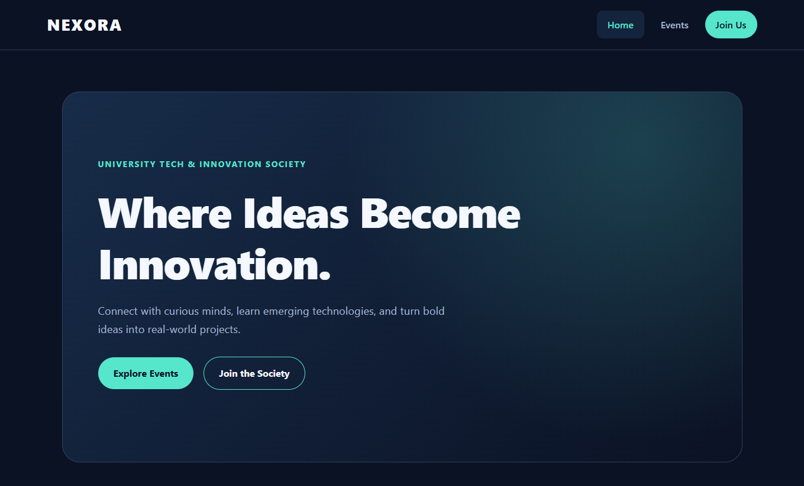

# NEXORA — University Tech & Innovation Society

## Project Overview
NEXORA is a 3 page university technology society website.
It helps students to explore events and register for activities.

## Website Pages
- Home: Introduction to NEXORA webite and featured activities.
- Events: there will be Four upcoming technology events.
- Join Us: its for Student registration form.

## Technologies Used
- HTML5
- CSS3
- JavaScript
- Browser localStorage

## How to Run
1. Download or clone this repository.
2. Open index.html in a browser.
3. Navigate between Home, Events and Join Us.
4. Use the registration form to save a registration.

## Features
- Responsive navigation and layout
- Event information
- Form validation
- Registration data stored in localStorage
- View and clear saved registrations

## Screenshots

## Image Credits
No external stock images were used.
## Author
Roll Number: 0068
Course: CIT331